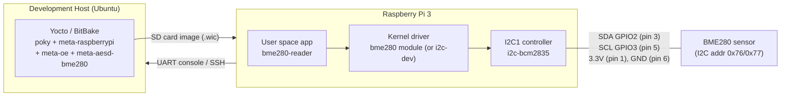

# Overview
This project builds a custom, minimal embedded Linux image with **Yocto** for a **Raspberry Pi 3** that reliably reads **temperature and barometric pressure** from a **Bosch BME280** sensor over the **I2C** bus.

**Goals**
1. Build the smallest Yocto image that boots on the Raspberry Pi 3 with I2C enabled.
2. Flash the image to the device and bring up the I2C bus.
3. Wire the BME280 and verify it is detected (chip ID `0x60` at address `0x76`/`0x77`).
4. Read compensated temperature and pressure values that are plausible and stable over time.
5. Stretch goal: do the sensor access through a **Linux kernel driver** (custom out-of-tree module), exposing readings to user space.

**Motivation**
The project covers the full embedded Linux workflow: building a custom distribution, board bring-up, hardware interfacing over a standard bus, and kernel driver development. A temperature and pressure node is also the basis for many real IoT and monitoring products.

## Block Diagram

# Target Build System
**Yocto Project** (Poky, Scarthgap 5.0 LTS release). Hardware support for the Raspberry Pi comes from the open-source Yocto layers listed below, all on the `scarthgap` branch:

| Layer | Source | Purpose |
| ----- | ------ | ------- |
| `meta`, `meta-poky`, `meta-yocto-bsp` | [poky](https://git.yoctoproject.org/poky/) | Core build system and reference distribution |
| `meta-raspberrypi` | [meta-raspberrypi](https://git.yoctoproject.org/meta-raspberrypi/) | Raspberry Pi BSP: kernel, bootloader/firmware, device tree overlays, `MACHINE = "raspberrypi3"` |
| `meta-oe` | [meta-openembedded](https://git.openembedded.org/meta-openembedded/) | Extra userspace packages such as `i2c-tools` |
| `meta-aesd-bme280` | This project | Custom image, BME280 driver and app recipes, and I2C/sensor configuration |

- Base image: `core-image-minimal`, extended in the custom layer `meta-aesd-bme280`
- I2C enabled through `ENABLE_I2C = "1"` and `KERNEL_MODULE_AUTOLOAD += "i2c-dev"`

# Hardware Platform
- **Raspberry Pi 3** (Model B/B+). This board is supported by the open-source [meta-raspberrypi](https://git.yoctoproject.org/meta-raspberrypi/) Yocto BSP layer ([docs](https://meta-raspberrypi.readthedocs.io/)). That layer provides the Raspberry Pi kernel, the GPU firmware and bootloader, and the device tree overlays used to enable I2C (`ENABLE_I2C = "1"`). Together with [meta-openembedded](https://git.openembedded.org/meta-openembedded/), it covers all hardware support, so no custom BSP work is needed.
- **BME280** breakout board (3.3V, I2C mode). [Datasheet](https://www.bosch-sensortec.com/products/environmental-sensors/humidity-sensors-bme280/)
- microSD card (8 GB or more), 5V/2.5A power supply, USB-to-TTL serial cable for the console, jumper wires.

| BME280 pin | Raspberry Pi 3 header pin |
| ---------- | ------------------------- |
| VIN / VCC  | Pin 1 (3.3V)              |
| GND        | Pin 6 (GND)               |
| SDA        | Pin 3 (GPIO2 / SDA1)      |
| SCL        | Pin 5 (GPIO3 / SCL1)      |

All hardware is self-sourced (1x Raspberry Pi 3, 1x BME280). No boards need to be borrowed from the department.

# Open Source Projects Used
- [Yocto Project / Poky](https://www.yoctoproject.org/): build system and reference distribution
- [meta-raspberrypi](https://git.yoctoproject.org/meta-raspberrypi/): open-source BSP layer for Raspberry Pi hardware support
- [meta-openembedded](https://git.openembedded.org/meta-openembedded/) (`meta-oe`): additional open-source recipes, including `i2c-tools`
- [i2c-tools](https://git.kernel.org/pub/scm/utils/i2c-tools/i2c-tools.git/) (`i2cdetect`, `i2cget`, `i2cdump`): bus bring-up and debugging
- Reference only: Linux mainline IIO driver `drivers/iio/pressure/bmp280*` and the [Bosch BME280 Sensor API](https://github.com/boschsensortec/BME280_SensorAPI), used for checking the compensation formulas

# Previously Discussed Content
- Yocto concepts from the course (layers, recipes, `local.conf`, `bblayers.conf`, building and deploying images)
- Linux kernel modules and character drivers, using `aesdchar` as the basis for the driver structure (`file_operations`, `read`, `ioctl`, locking)
- Cross-compilation and out-of-tree module builds through Yocto (`module` bbclass)
- Optionally `aesdsocket`, to serve sensor readings over the network

# New Content
**Discussed in class but not covered in assignments**
- Running on real hardware instead of QEMU: SD card flashing, serial console, and board bring-up
- Device tree and overlays, used to enable I2C1 and describe the sensor

**Not yet discussed in class**
- The I2C bus protocol and the Linux I2C subsystem (`i2c_driver`, `i2c_client`, `i2c_smbus_*` APIs, `/dev/i2c-*`)
- BME280 register map, calibration (trim) data, and fixed-point compensation algorithms
- Writing a custom Yocto layer with a kernel-module recipe and user-space app recipe for a physical board

# Shared Material
N/A. No code will be reused from other coursework or previous semesters. The mainline Linux `bmp280` driver and the Bosch Sensor API are used only as references for the compensation math.

# Source Code Organization
All project source will be hosted in a single repository at [diferrans1/aeld-final-project](https://github.com/diferrans1/aeld-final-project). This includes:
- The Yocto custom layer `meta-aesd-bme280`, the build configuration, and setup scripts
- The BME280 kernel driver and the user-space reader app

No additional repositories are requested.

# Schedule Page
See [Final Project Schedule](Final-Project-Schedule)
